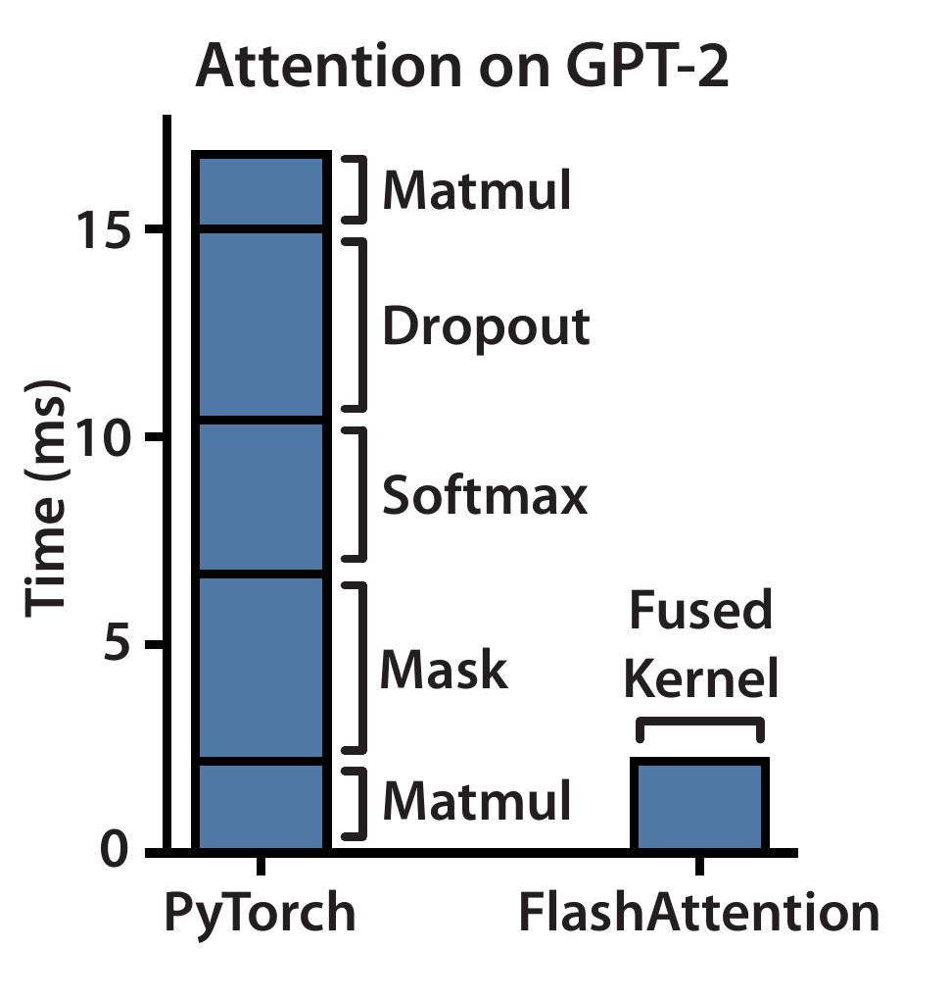
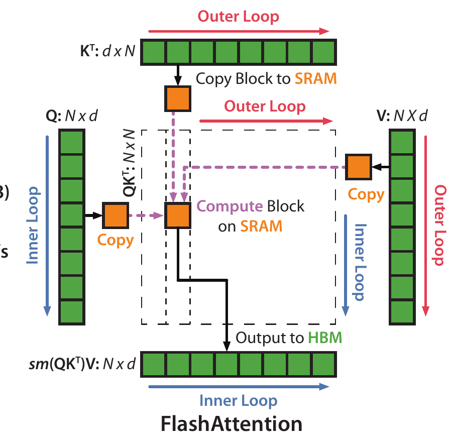
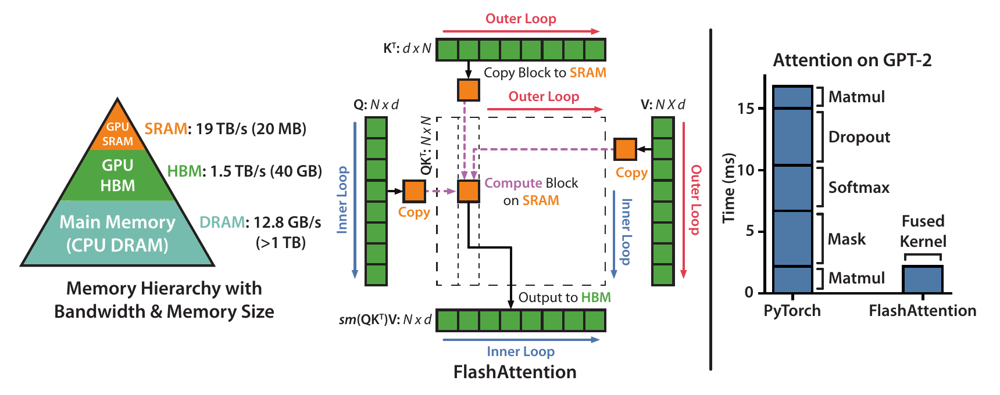

Linformer compresses the sequence dimension with low-rank projections. Longformer uses local windows and selected global connections. Both pursue a natural idea: **make attention cheaper by computing less of it**.

But fewer operations do not guarantee a faster GPU program. Memory transfers and hardware utilization also matter. These methods are not failures; approximate methods can win at longer sequence lengths. FlashAttention asks a different question:

> Can the same dense attention run faster by moving less data, even if training requires more arithmetic?

Start with the paper's measured runtime. Then play the memory-flow animations: **what crosses the HBM boundary, and what stays on chip?**

<figure class="fa-paper">
<h3 class="fa-paper-title">The expensive part is not just matrix multiplication</h3>
<a class="fa-paper-image" href="https://arxiv.org/pdf/2205.14135v2#page=2" target="_blank" rel="noopener"></a>
<div class="fa-paper-reading"><p><b>Read the tall bar</b>Mask, softmax and dropout occupy much of the time, although they do less arithmetic than the matrix multiplications.</p><p><b>Ask what each stage moves</b>Separate stages read and write large arrays. Low arithmetic per transferred byte makes memory traffic expensive.</p></div>
<figcaption><strong>Original Figure 1, right panel.</strong> Dao et al., FlashAttention (2022), PDF p. 2. Cropped from the source, not redrawn. The paper reports 7.6× attention speedup here, not 7.6× whole-model training speedup. Stage duration includes computation and memory effects; it is not a direct measurement of idle time. <a href="https://arxiv.org/pdf/2205.14135v2#page=2">Read the original figure and caption.</a></figcaption>
</figure>

## 1. A large warehouse and a small workbench

**Memory stores numbers. Compute units perform arithmetic.** A large store holds all the materials; a small nearby working area makes repeated use cheaper.

On a CPU, RAM holds working data and a cache keeps nearby copies. On a GPU, HBM is large DRAM-based device memory. SRAM is the technology behind small on-chip stores, including shared memory and caches.

<div class="explainer" data-explainer="fa-hardware"></div>

**SRAM does not mean cache.** A cache is mostly managed automatically; shared memory is explicitly managed by the kernel. Registers hold live operands and accumulators. Local storage belongs to individual SMs, not one enormous shared workbench. The diagram omits cache layers.

Capacity is how much fits. Bandwidth is bytes moved per second. A memory-bound stage does little arithmetic for each byte it must move: faster arithmetic cannot remove that transfer cost. The animation illustrates this dependency, not measured GPU utilization or exact timing.

## 2. Where the ordinary implementation spends its trips

For one head, the familiar computation is:

```math
S=QK^\top/\sqrt d,\qquad P=\operatorname{softmax}(S),\qquad O=PV.
```

S and P are \(N\times N\); O is \(N\times d\). A separated implementation writes S to HBM, reads it for softmax, writes P, then reads P for the multiplication by V.

<div class="explainer" data-explainer="fa-traffic"></div>

A single FP16 score matrix at \(N=4096\) occupies **32 MiB per head and batch element**. Repeatedly moving that intermediate can cost more than its arithmetic. Modern attention APIs may already select a fused implementation; this diagram compares against the separated baseline.

## 3. Tiling: use the intermediate before it leaves

Bring in Q/K/V blocks that fit locally. Compute a small score tile, consume it into the output summary, then discard it. Reuse the freed space for the next tile.

<figure class="fa-paper">
<h3 class="fa-paper-title">The paper's loop, before pressing Play</h3>
<a class="fa-paper-image" href="https://arxiv.org/pdf/2205.14135v2#page=2" target="_blank" rel="noopener"></a>
<figcaption><strong>Original Figure 1, center panel.</strong> Red: one K/V block remains local while blue visits each Q block. The dotted score matrix is not stored in HBM. Dao et al. (2022), PDF p. 2. <a href="https://arxiv.org/pdf/2205.14135v2#page=2">Source and full caption.</a></figcaption>
<details><summary>View all three original Figure 1 panels</summary><p>The memory pyramid shows aggregate GPU SRAM figures, not one SM's capacity. The physical animation labels per-SM resources separately.</p></details>
</figure>

<div class="explainer" data-explainer="fa-original-loop"></div>

The key is not merely slicing a matrix. It is keeping **score calculation, softmax updates, and multiplication by V together**, without writing the full S or P to HBM.

The animation follows the original loop order: **K/V outside, Q inside**. Each visit reads and rewrites that Q block's partial output and row statistics. Watch the output blocks become complete only after all three K/V blocks. The progress fill means processed blocks, not the magnitude of the answer. Larger tiles must still fit local memory and register budgets.

But softmax needs the whole row's denominator. How can one tile be finished before the next arrives?

## 4. Softmax: two divisions with different jobs

Softmax exponentiates scores, then divides each result by their total:

```math
p_j=\frac{e^{s_j}}{\sum_k e^{s_k}}.
```

Choose scores \([0,\ln2,\ln4,\ln8]\), so their exponentials are \([1,2,4,8]\). These are **unnormalized weights**, not probabilities: their sum is 15.

<div class="explainer" data-explainer="fa-normalize" data-mode="0"></div>

Subtracting the maximum score makes the largest exponential 1. Here it divides every weight by 8, preserving their ratio. Their sum becomes 1.875, still not 1. **Only dividing by that sum produces probabilities.**

Thus “divide by 8” rescales; “divide by the total” normalizes. In a real implementation, compute \(e^{s_j-m}\) directly to avoid overflowing before rescaling, rather than first forming huge exponentials.

## 5. Why the division can wait

Take weights \([1,3]\) and values \([10,20]\). The ordinary path first makes probabilities \([1/4,3/4]\), then multiplies them by V. But both terms have the same denominator.

<div class="explainer" data-explainer="fa-average"></div>

This is ordinary addition of fractions, not a new softmax identity. Give the numerator and denominator names:

```math
w_j=e^{s_j-m},\qquad
u=\sum_jw_jV_j,\qquad
\ell=\sum_jw_j,\qquad O=\frac{u}{\ell}.
```

The index k in the softmax denominator simply means “sum over all keys.” Every j in the same query row shares that denominator. For vector V, u is a vector too; divide every component by the same scalar \(\ell\).

**We can accumulate numerator and denominator separately, then divide once.** We do not need to store every completed probability.

## 6. Online softmax: keep the summary, change its scale

“Online” means processing incoming blocks. Each query row keeps **m**, its largest score so far; **\(\ell\)**, its weight sum; and **u**, its V-weighted sum.

When a larger maximum arrives, all old weights need the same rescaling. Apply that multiplier directly to their two totals. No old score needs to be retrieved.

<div class="explainer" data-explainer="fa-online" data-mode="1"></div>

The example uses A's values \([10,20]\) and B's values \([30,40]\). A first gives \(m=\ln2,\ell=1.5,u=25\). B raises the reference to \(\ln8\), so the old totals are multiplied by \(2/8=1/4\). Add B's contribution and the final output is \(61.25/1.875=32.6667\ldots\).

**Rescaling preserves A's own weighted average; adding B changes the overall answer.** If the maximum does not increase, the rescaling factor is 1. Applying softmax separately to each tile would be wrong: each tile would assign itself a probability total of one.

<details>
<summary>The update, in three lines</summary>

```math
m'=\max(m,\max s_{\mathrm{new}}),\qquad \alpha=e^{m-m'}.
```

```math
\ell'=\alpha\ell+\sum_{j\in\mathrm{new}}e^{s_j-m'},
\qquad
u'=\alpha u+\sum_{j\in\mathrm{new}}e^{s_j-m'}V_j.
```

Initialize from the first valid block and return \(u/\ell\) after the last. The formulas omit dropout and assume finite valid scores. Masked blocks require appropriate handling. With dropout, the denominator uses undropped weights; numerator contributions use the dropout mask and its scaling. Implementations can maintain an equivalent normalized output accumulator instead of u.

</details>

## 7. Backward: reconstruct the tile instead of fetching the matrix

If \(O=0.25V_1+0.75V_2\), an upstream scalar gradient g gives \(dV_1=0.25g\) and \(dV_2=0.75g\). **Backward needs the weights again.**

A conventional approach saves P. FlashAttention keeps the required inputs, output, and row-normalization statistics, then reconstructs P a tile at a time.

<div class="explainer" data-explainer="fa-recompute"></div>

The saved statistics describe the **entire row**, not just the tile. Original FlashAttention saves m and \(\ell\); an equivalent representation is \(L=m+\log\ell\), giving \(P_j=e^{s_j-L}\).

Q/K blocks are still read and gradients still written. The saving is not zero I/O: it is avoiding the huge saved P matrix. Recomputing can win when the added arithmetic costs less than the memory traffic it replaces. Dropout requires consistently regenerated masks.

## 8. More arithmetic, less time

The paper's A100 experiment increases arithmetic but sharply reduces memory traffic. Switch metrics to see why FLOPs alone tell the wrong story.

<div class="explainer" data-explainer="fa-benchmark"></div>

The attention comparison is Figure 2's forward-plus-backward benchmark, not a whole-model benchmark. Table 2's training times use different baselines and report the same perplexity. **Traffic in GB is not peak allocated memory, and these results do not promise a universal tenfold speedup over modern kernels.**

Three boundaries remain:

- **Dense arithmetic is still quadratic.** Less intermediate storage is not linear-time attention.
- **Exact is not bitwise identical.** Floating-point reduction order changes.
- **Hardware and workload matter.** Tile sizes, masks, precision, head dimension, and sequence length affect the result. Approximate methods remain useful.

Tiling keeps intermediates local. Online softmax keeps only the needed summary. Recomputation extends that saving to backward. **The central optimization is the lifetime and location of data, not skipping the dense attention function.**

## References

- [FlashAttention](https://arxiv.org/abs/2205.14135), 2022: Sections 2–3, Figure 2, Table 2, Appendix B.
- [Linformer](https://arxiv.org/abs/2006.04768) and [Longformer](https://arxiv.org/abs/2004.05150), 2020.
- [NVIDIA Ampere Tuning Guide](https://docs.nvidia.com/cuda/ampere-tuning-guide/index.html): memory hierarchy and shared-memory limits.
- [CODER X DOX's FlashAttention discussion](https://www.youtube.com/watch?v=vL0d9in1Y-I): the video motivating this explanation.
